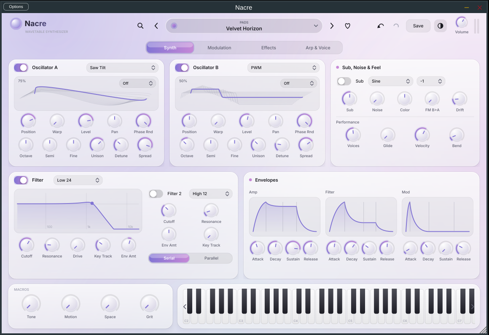
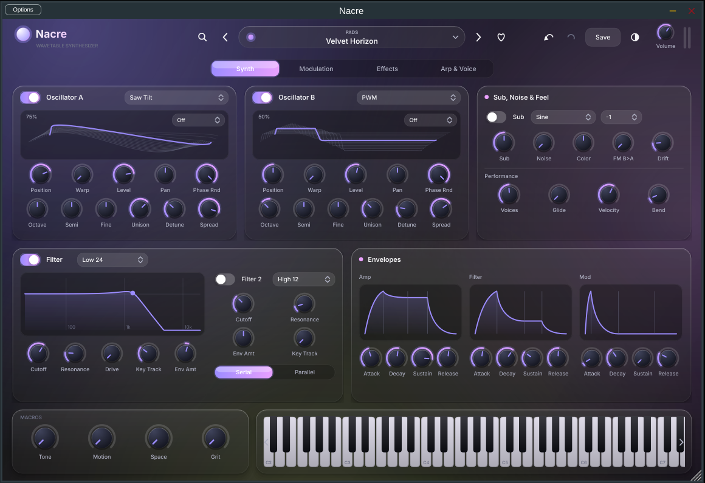

# Nacre

A wavetable synthesizer plug-in (VST3, plus AU and Standalone on macOS) with 422
level-matched factory sounds, 43 wavetables, 42 effect-rack presets, and a light/dark
interface designed after Apple's system apps.




## What's inside

**Sound engine**
- 2 wavetable oscillators, 43 tables x 32 frames, plus 4 warp modes (Sync, Bend, Squeeze, Mirror)
- Up to 7-voice unison per oscillator with detune, stereo spread and phase randomisation
- FM (oscillator B phase-modulating A), sub oscillator (4 shapes), coloured noise
- 2 filters, serial or parallel: Low 12/24, Ladder, High 12/24, Band, Notch, Comb, Vowel, with drive and key tracking
- 3 envelopes, 3 LFOs (7 shapes, tempo sync, fade-in, per-voice or global)
- 12-slot modulation matrix with a "via" scaler on every slot (e.g. LFO x Mod Wheel), 16 sources, 32 destinations
- 4 macros (Tone, Motion, Space, Grit), mapped on every factory sound
- Arpeggiator: 6 modes, 1-4 octaves, swing, gate, latch, locked to the host tempo
- Poly (up to 32 voices), Mono and Legato with glide; sustain pedal; analog drift

**Effects** (in this order): Distortion (6 types, run oversampled) > Phaser > Chorus > Delay (sync, ping-pong) >
Reverb (8-line FDN) > 3-band EQ > Compressor > Volume > safety limiter.
The *Effect presets* menu swaps just the rack, so any sound can go into any space.

**Sounds**: 422 presets across 16 categories: Pads, Atmospheres, Keys, Bass, Leads, Plucks, Bells & Mallets,
Strings, Brass & Winds, Organs, Choirs & Vox, Arps & Sequences, Chords & Stabs, Drones, FX & Risers, Percussion.
Browser with search, categories, favourites and your own presets.

## Details that matter in a session

- **Every factory sound is loudness-matched.** Each one was rendered with a phrase that suits it and measured
  with ITU-R BS.1770 integrated loudness, then set to the same target (-16 LUFS, never peaking above -3 dBFS; drums are matched by peak).
  You can browse without riding the fader.
- **No aliasing on high notes.** Wavetables are band-limited per octave, and voices and distortion run at 2x the
  sample rate through a polyphase half-band decimator (more than 100 dB of rejection). Measured alias rejection on a bright saw
  at 2.6 kHz: -65 dB. An *Eco* quality switch halves CPU when you need it.
- **Zero latency**, sample-accurate MIDI and automation, click-free voice stealing, and a 12 ms fade on preset changes
  so switching sounds while the track plays never pops.
- **The output can't hurt you**: a transparent limiter at -0.3 dBFS, a DC blocker, and a guard that silences and
  resets the engine if anything ever produces a NaN.
- **Works with the host**: tempo-synced LFOs, delay and arp lock to the host's beat position; every control is
  automatable with proper value text ("1.23 kHz", "250 ms"); undo/redo for every change; the factory list is exposed
  as host programs.
- **Presets survive updates.** The format is plain text, stores choices by name and ignores unknown fields, so adding
  wavetables or parameters later never breaks a saved song or preset.
- Mod wheel = vibrato (or brightness on pads and beds), aftertouch = brightness, on every sound.
- Resizable UI (50%-200%), remembers its size, theme and page.

## Verified so far

- Engine test suite (`nacre_render test`): pitch accuracy, alias rejection, voice stealing without clicks,
  block-size independence, 22.05-192 kHz, arpeggiator timing, sustain pedal, 1,500 blocks of random-parameter abuse.
- [pluginval](https://github.com/Tracktion/pluginval) at strictness 10 (its strictest level) passes on the VST3,
  including the editor, state restore, thread-safety, fuzzing and allocation-in-audio-thread tests; a second pass at
  22.05/44.1/192 kHz with block sizes 1, 13, 333 and 4096 passes too.
- CPU: 8 notes x 2 oscillators x 7 unison voices with both filters and every effect on uses about 15% of one core at 48 kHz.

Those checks were run on a Linux build. The Windows and macOS builds come from the included GitHub workflow,
which runs the same tests and pluginval.

## Getting the plug-in

There is no pre-built download in this folder: the plug-in has to be compiled once for your computer.
Pick whichever is easier.

### Option A: let GitHub build it (no tools needed)

1. Create a new repository on GitHub and upload this folder.
2. Open the **Actions** tab. The *Build Nacre* workflow runs automatically (about 10 minutes).
   It builds Windows and macOS versions, runs the engine tests, and validates the VST3 with
   [pluginval](https://github.com/Tracktion/pluginval) at its strictest level.
3. Download the **Nacre-Windows** artifact, unzip it, right-click `install-windows.ps1` > *Run with PowerShell*.

### Option B: build it on your Windows PC

1. Install [Visual Studio 2022 Community](https://visualstudio.microsoft.com/) with the *Desktop development with C++* workload
   (this includes CMake), and [Git](https://git-scm.com/).
2. Open *x64 Native Tools Command Prompt for VS 2022* in this folder and run:
   ```
   cmake -B build -G "Visual Studio 17 2022" -A x64
   cmake --build build --config Release --parallel
   ```
   CMake downloads JUCE 8.0.15 automatically the first time.
3. Copy `build\Nacre_artefacts\Release\VST3\Nacre.vst3` to `C:\Program Files\Common Files\VST3\`
   (or configure with `-DNACRE_COPY_AFTER_BUILD=ON` to have it copied for you; that needs an administrator prompt).

### Load it in FL Studio

*Options > Manage plugins*, make sure the VST3 folder is listed, click **Find installed plugins**, tick the star next
to Nacre, then add it from the Channel Rack (+) like any instrument. The standalone `Nacre.exe` also works without a DAW.

### If Nacre doesn't show up or won't load

1. The folder must be installed as a whole: `C:\Program Files\Common Files\VST3\Nacre.vst3\Contents\x86_64-win\Nacre.vst3`.
   Using `install-windows.ps1` does this and also removes Windows' "downloaded from the internet" block.
   On macOS run `install-mac.command` (it clears the quarantine flag that otherwise makes hosts refuse the plug-in).
2. In FL Studio open *Options > Manage plugins*, tick **Verify plugins**, then **Find installed plugins**. Instruments appear under
   *Add > More plugins* / the Channel Rack (+) menu, not in the effects list.
3. Build the **Release** configuration only (a debug build is far too slow to load); the CMake file now allows only Release.
4. Nacre writes a short log to `%TEMP%\Nacre-log.txt` (macOS/Linux: `$TMPDIR/Nacre-log.txt`). The last line shows how far loading got:
   `processor: constructing` > `processor: ready` > `editor: building UI` > `editor: ready`. If it stops early, that is the culprit.

### About VST2

FL Studio fully supports VST3, so that's what Nacre ships. Steinberg stopped licensing the VST2 SDK to new developers
in 2018, so a VST2 build can't be distributed legally unless you already hold a VST2 licence.
(On macOS an Audio Unit is built as well.)

## Using it

- **Browse:** click the sound name (or Ctrl/Cmd+F). Click a sound to hear it, Up/Down to step, Enter or double-click to close.
  The arrows either side of the name step through the current category. The heart marks favourites.
- **Controls:** drag up/down, hold **Shift** for fine control, **double-click** to reset, hover to read the exact value.
- **Save:** Ctrl/Cmd+S or *Save*. User presets are text files in `Documents/Nacre/Presets` and appear under *User*.
- **Undo/redo:** Ctrl/Cmd+Z and Ctrl/Cmd+Shift+Z.

## For developers

```
engine/     the synth: pure C++17, no framework, unit-testable
  Params.h        single parameter table (ids, ranges, curves, units) shared by everything
  Synth.*         voices, modulation, arpeggiator, effect chain
  Wavetables.*    the 43 procedurally generated tables
  Effects.h, Dsp.h
  FactoryPresets.cpp   generated
plugin/     JUCE wrapper and interface
tools/
  nacre_render.cpp     unit tests, loudness analysis, WAV rendering
  make_presets.py      the sound library, written as recipes
  level_presets.py     renders, measures, level-matches and embeds the library
```

- Run the engine tests without JUCE: `cmake --build build --target nacre_render && build/nacre_render test`
- Change or add sounds: edit `tools/make_presets.py`, build `nacre_render`, then run `python3 tools/level_presets.py`.
  It refuses to finish if a sound is silent, produces NaN, has DC offset, or doesn't decay.
- Add a wavetable: append a generator in `Wavetables.cpp`, append its name to `NACRE_WT_NAMES` in `Params.h`
  and bump `kNumTables`. Only ever *append* to choice lists.
- Before releasing, change `PLUGIN_MANUFACTURER_CODE`, `PLUGIN_CODE` and `BUNDLE_ID` in `CMakeLists.txt` to your own,
  and code-sign the macOS build.

## Licences

Nacre's own code is yours. It is built with [JUCE](https://juce.com), which is free for personal use and for
companies under its revenue threshold, and otherwise needs a commercial JUCE licence; check the current JUCE terms
before selling the plug-in. The interface font is [Inter](https://rsms.me/inter/) (SIL Open Font License,
see `plugin/fonts/OFL.txt`). VST is a trademark of Steinberg Media Technologies GmbH.
